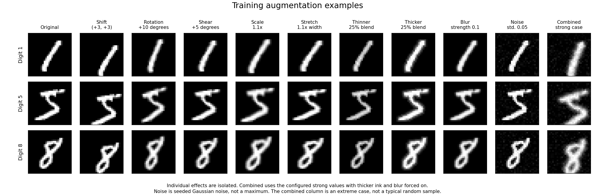
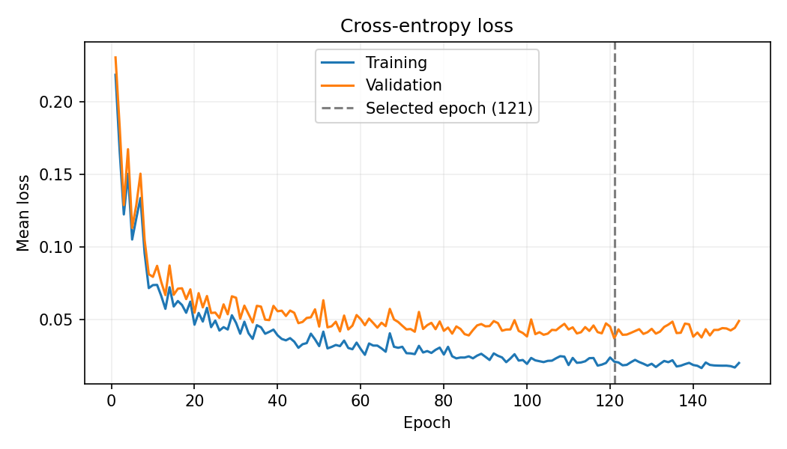
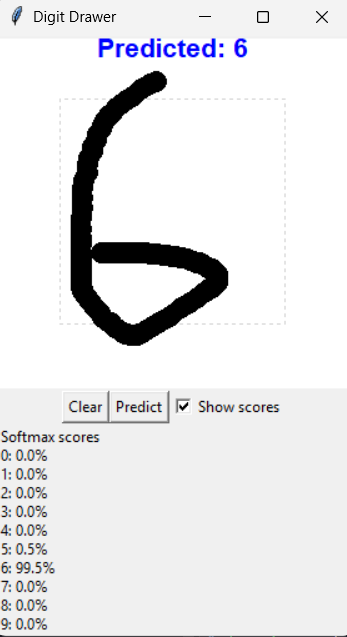

# Neural Network Project

## Introduction

This was my first neural network project. I wanted to understand how neural networks actually learn, so I implemented the forward propagation and backpropagation myself using NumPy.

The network is trained on the MNIST dataset to recognize handwritten digits. I also made a drawing GUI where you can draw a digit yourself and see what the network predicts.

The initial version did not preprocess the drawings in exactly the same format as MNIST, so there was a significant drop in accuracy on drawings from the GUI compared with MNIST. I have now tried to preprocess the drawings from the GUI to match MNIST more closely, using scaling and centering.

## How to Run

Use **Python 3.11** with Tkinter available. Before creating the environment, check that `python --version` reports Python 3.11.

Clone the repository:

```bash
git clone https://github.com/HenrikTorp/FirstNeuralNetwork.git
cd FirstNeuralNetwork
```

Create a virtual environment:

```bash
python -m venv venv
```

Activate it in Windows PowerShell:

```powershell
.\venv\Scripts\Activate.ps1
```

Install the dependencies:

```bash
python -m pip install -r requirements.txt
```

The GUI requires `models/digit_recog.pkl`. If that checkpoint is not included, train the network first. For training, download the [MNIST archive](https://storage.googleapis.com/tensorflow/tf-keras-datasets/mnist.npz) and place it at `data/mnist.npz`, or edit `MNIST_PATH` in `src/data.py` to use another local archive.

```bash
python -m src.training.trainer
```

After each completed epoch, training saves the loss and accuracy history and run settings to `models/digit_recog_history.json`. To redraw the loss plot from that file without training again:

```bash
python -m src.training.plots
```

Launch the drawing GUI from the repository root:

```bash
python -m main
```

Draw a digit and click **Predict**. Select **Show scores** to inspect the model's output for each digit, or click **Clear** to start again.

## Network Architecture

When I first made this, I used sigmoid as the activation function. I have since switched the hidden layers to ReLU, which is less prone to vanishing gradients. For a network as small as this, sigmoid is still a reasonable choice, and it has certain advantages as well.

The architecture of the network is 784 input neurons (28×28 pixels flattened into a vector), and two hidden layers of 256 and 128 neurons respectively, followed by 10 outputs using softmax. There is no big trick to this particular architecture; it just seems to work reasonably well for a relatively simple classification problem like MNIST.

I also implemented Adam in NumPy. Training uses validation loss for early stopping and restores the weights from the best epoch.

## Mathematical fixes

Two parts of the original implementation were corrected during cleanup:

- **Gradient averaging:** the loss was averaged across each batch, but the gradients were summed. The gradients are now divided by the actual batch size so they match the mean loss.
- **Cross-entropy calculation:** the original calculation clipped very small probabilities before taking their logarithm. This capped the reported loss for very confident wrong predictions, while backpropagation continued producing gradients. The loss is now calculated directly from the scores before softmax, avoiding that mismatch.

## Data augmentation

I augment the training images with changes to position, shape and stroke width, plus mild blur and noise. Validation and test images are left unchanged.



## Results

The network achieved **99.09% accuracy on the MNIST test set** and correctly classified **all 141 saved drawings**.

The selected model came from epoch 121, with a validation loss of 0.0368.



## Demo


